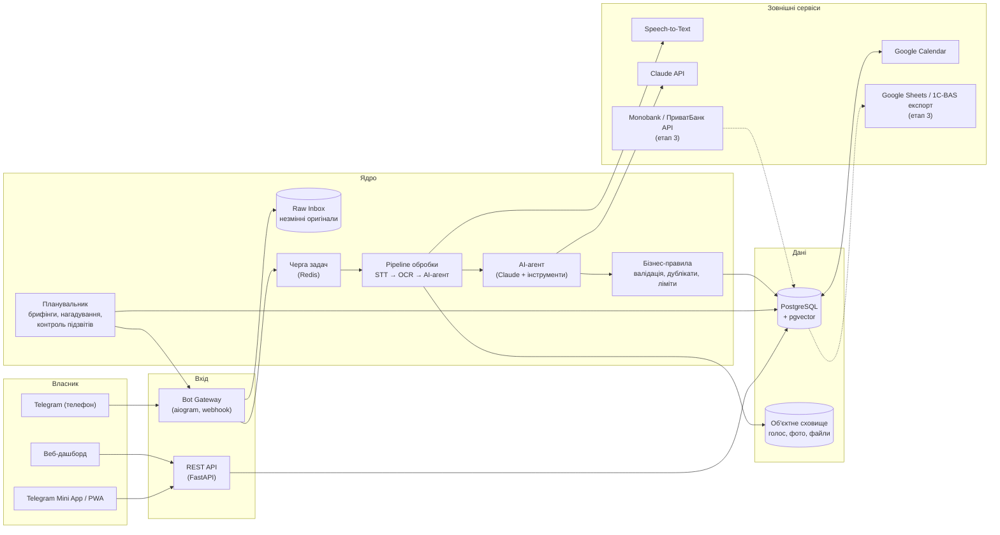
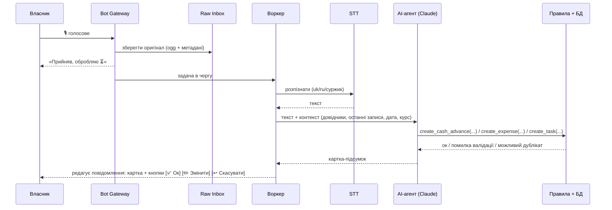
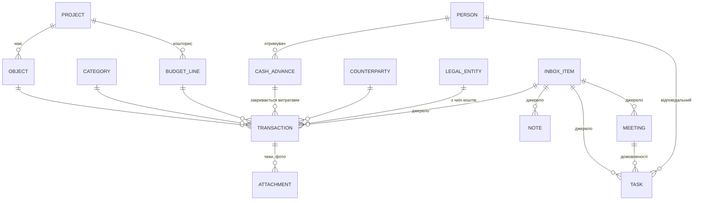

# Персональний AI-асистент забудовника ЖК — архітектура (v0.1, на погодження)

> Робоча назва: **«Прораб-асистент»** (можна змінити).
> Статус: чернетка архітектури. Код не пишемо, доки ви не погодите цей документ і не дасте відповіді на питання з розділу 14.

---

## 0. Оновлення v0.2: пілот на один ЖК (має пріоритет над розділами нижче)

Рішення замовника: зараз робимо **пілот на один ЖК**, без ускладнень. Тестуємо місяць, потім масштабуємо. Склад узгоджено після перегляду з позицій власника-забудовника, фінансового директора, головного інженера та продакт-менеджера.

**Користувачі:** двоє, власник (бачить усе) і прораб (бачить тільки свої гроші й задачі). Один ЖК, одна юрособа, без складних прав.

**Крок 1 «Фундамент» (пілот, 3–4 тижні до запуску):**
1. Голос, текст і фото: витрати, задачі, ідеї, нотатки, зустрічі, нагадування.
2. **Гроші під звіт прорабу**:
   - видачу підтверджують з двох боків («видав» / «отримав»);
   - прораб сам скидає фото чеків;
   - для витрат без чека є окремий тип;
   - бот рахує, скільки грошей на руках, і нагадує прорабу про чеки.
3. **Погодження оплат**: прораб скидає рахунок або запит, власник погоджує однією кнопкою, оплачене стає витратою.
4. **Підрядники, мінімально**: сума договору, аванси, акти, одна цифра (невідпрацьований аванс або наш борг). Звіт щоп'ятниці.
5. **10–12 статей витрат за етапами будівництва** з першого дня: нульовий цикл, каркас, стіни, покрівля, інженерні мережі, фасад, оздоблення, благоустрій, документи, інше.
6. Звіти: ранковий план, вечірній підсумок (з питанням «сьогодні платили?»), тижневий звіт у п'ятницю.
7. Кабінет на один екран і вивантаження в Excel для бухгалтера.

**Крок 2 «Поверхи» (після тесту, по 1–2 за раз):** перевірка «оплатили, а чи привезли?» за накладними, фотозвіти з майданчика, терміни документів, протокол наради з аудіозапису, контроль чужих обіцянок, собівартість 1 м² план/факт, роль фінансиста, кілька ЖК і юросіб, банки.

**Критерії успіху через місяць:**
- власник записує щось щонайменше 20 днів із 30;
- залишок «на руках у прораба» збігається з реальністю;
- з'явилася хоча б одна нова цифра (наприклад, невідпрацьовані аванси);
- хоча б 3 рази нагадування врятувало від пропуску;
- на питання «вимкнути — буде шкода?» власник відповідає «так».

**Вплив на модель даних (розділ 7):**
- додаються сутності `Contract` (підрядник, сума) і `PaymentRequest` (рахунок → погоджено / відхилено → оплачено);
- `CashAdvance` отримує підтвердження отримання і витрати без чека;
- `Category` стає списком етапів будівництва;
- ієрархію Project/Object, кілька юросіб і BudgetLine відкладаємо до кроку 2.

---

## 1. Що ми вирішуємо

**Проблема.** Власник (забудовник) за день робить десятки дрібних дій: віддає готівку прорабу, оплачує бетон, домовляється про зустріч, придумує ідею по планування квартир, обіцяє комусь передзвонити. Більшість цього ніде не фіксується — і потім губиться: гроші «розпливаються», задачі забуваються, зустрічі не мають підсумків.

**Рішення.** Асистент у Telegram, якому власник **голосом або текстом** «скидає все підряд», а асистент:

1. розуміє, *що це* (витрата, видача під звіт, задача, ідея, нотатка, зустріч, нагадування, питання);
2. розкладає це в структуровані дані (сума, валюта, об'єкт, стаття витрат, хто отримав, дедлайн…);
3. коротко підтверджує власнику, що і куди записав (з можливістю виправити одним тапом);
4. сам нагадує, контролює, підсумовує (ранковий брифінг, вечірній звіт, «як пройшла зустріч?»);
5. показує все у веб-дашборді та мобільній версії.

**Головний принцип: «нічого не губиться».** Кожне повідомлення (текст, голос, фото чека) зберігається в незмінному вигляді *до* будь-якої обробки. Навіть якщо AI помилився — оригінал є, і його можна переобробити.

---

## 2. Аналіз існуючих рішень — що беремо, чого уникаємо

| Рішення / підхід | Що добре | Чого бракує для забудовника | Що запозичуємо |
|---|---|---|---|
| **Getting Things Done (GTD) / «Inbox»** (Things, Todoist) | Все спочатку падає в «вхідні», потім розбирається | Розбирати треба вручну | Єдиний *Inbox* для всього; AI робить розбір замість людини |
| **Mem.ai, Reflect, Notion AI, Saner.ai** («другий мозок») | Вільний ввід, семантичний пошук, AI-підсумки | Немає фінансів, немає Telegram-першого UX, немає контролю | Семантична пам'ять + пошук «що я казав про…» |
| **Expensify / Ramp / SmartScan** | OCR чеків, категоризація витрат, звіти | Корпоративні сценарії, не підзвітна готівка, не UA-реалії | Фото чека → автоматичне заповнення; правила категоризації |
| **Motion, Reclaim.ai** | AI-планування в календарі | Тільки календар | Синхронізація з Google Calendar, автонагадування |
| **Lindy, OpenClaw-подібні агенти в месенджерах** | Агент з інструментами в Telegram/WhatsApp, проактивність | Загальні, без доменної моделі будівництва; ризик «агент робить що хоче» | Агент з набором *чітко обмежених* інструментів + підтвердження |
| **MemGPT/Letta, Mem0** (архітектури пам'яті) | Розділення короткої / довгої / сутнісної пам'яті | Це бібліотеки, не продукт | Трирівнева пам'ять (див. розділ 6) |
| **Бот + Google Sheets** (типове «саморобне» рішення) | Дешево, швидко | Ламається на 2-му місяці: немає структури, пошуку, контролю | Експорт у Sheets залишаємо як додатковий вихід |

**Висновок.** Готового продукту, який поєднує *фінанси (зокрема підзвіт готівкою) + задачі/ідеї + календар + контроль* з голосовим вводом у Telegram і доменом будівництва — немає. Але всі «цеглинки» перевірені ринком. Наша цінність — **доменна модель забудовника + один вхід (Telegram) + проактивний контроль**.

---

## 3. Ключові сценарії (user stories)

| # | Власник каже / робить | Що робить асистент |
|---|---|---|
| S1 | 🎙 «Віддав Петровичу 10 тисяч на розетки й автомати для другої секції» | Створює **видачу під звіт** (не витрату!): 10 000 ₴, отримувач — Іван Петренко (прораб), об'єкт — ЖК/секція 2, призначення — електрика. Відкритий підзвіт. Пізніше просить чеки / залишок. |
| S2 | 📸 фото чека з Епіцентру | OCR → сума, позиції, продавець, дата → прив'язка до відкритого підзвіту Петровича або нова витрата |
| S3 | «Заплатив за бетон М300 18 кубів, 62 400, безнал з ТОВ» | Витрата: Матеріали → Бетон, 62 400 ₴, рахунок ТОВ, кількість 18 м³, ціна за м³ — розрахована |
| S4 | «Ідея: на першому поверсі зробити комерцію замість квартир» | Ідея → проєкт ЖК, тег «планування», без дедлайну |
| S5 | «Треба до п'ятниці погодити кошторис покрівлі з Олегом» | Задача: дедлайн пт, відповідальний — власник, контакт — Олег (покрівельник), нагадування в чт ввечері |
| S6 | «Завтра о 10 зустріч з архітектором у мерії» | Подія в Google Calendar, нагадування за 1 год, після зустрічі: «Як пройшла? Які домовленості?» → задачі з підсумків |
| S7 | Одне повідомлення з кількома діями: «Заплатив 5к за вивіз сміття, і нагадай завтра подзвонити в Укрбуд» | Розбиває на 2 записи: витрата + нагадування |
| S8 | «Скільки ми витратили на бетон у жовтні по другій секції?» | Відповідь з цифрою, розбивкою і посиланням на дашборд |
| S9 | «Хто мені ще не звітував за гроші?» | Список відкритих підзвітів з сумами і давністю |
| S10 | (нічого не каже) | 08:00 — брифінг дня; 20:00 — підсумок: витрати за день, нові задачі, незакриті питання |

---

## 4. Загальна архітектура



### 4.1. Компоненти

| Компонент | Відповідальність | Технологія |
|---|---|---|
| **Bot Gateway** | Приймає повідомлення Telegram, перевіряє, що пише дозволений користувач, миттєво відповідає «прийняв ⏳», кладе в Inbox і чергу | Python, `aiogram 3`, webhook |
| **Raw Inbox** | Незмінний журнал усього вхідного: текст, файл голосу, фото, час, chat_id. Ніколи не видаляється | Таблиця PostgreSQL + файли в S3 |
| **Pipeline-воркер** | Асинхронна обробка: голос → текст, фото → дані, потім AI-агент | `arq` / Celery + Redis |
| **AI-агент** | Розуміє намір, витягає структуру, викликає інструменти (записати витрату, створити задачу…), формує відповідь | Claude API, tool use зі strict-схемами |
| **Бізнес-правила** | Детермінована перевірка *після* AI: суми > 0, валюта, дублікати, ліміти, обов'язкові поля. AI пропонує — код вирішує | Python (Pydantic) |
| **Планувальник** | Брифінги, нагадування, контроль підзвітів, follow-up після зустрічей, синхронізація календаря | APScheduler / cron-воркер |
| **REST API** | Дані для дашборду, редагування, фільтри, експорт | FastAPI |
| **Дашборд** | Веб + мобільна версія (адаптивна PWA) + Telegram Mini App | Next.js + Tailwind + графіки |

### 4.2. Чому саме так

- **Telegram — єдиний «пульт»**, дашборд — для перегляду, аналізу й масового редагування. Власнику не треба вчити нову програму.
- **Асинхронність.** Голос на 2 хвилини обробляється 5–15 секунд; бот одразу відповідає «прийняв», а потім редагує це ж повідомлення результатом. Нічого не зависає.
- **AI не пише в базу напряму.** Він викликає *наші* функції з жорсткими схемами, а код перевіряє дані. Це захищає від «галюцинацій» у фінансах.
- **Мобільна версія = PWA + Telegram Mini App**, а не нативний застосунок на старті: одна кодова база, відкривається прямо з Telegram кнопкою «📊 Дашборд», без App Store. Нативний застосунок — тільки якщо з'явиться реальна потреба.

---

## 5. Потік обробки одного повідомлення



### 5.1. Картка підтвердження (приклад)

```
💸 Видано під звіт
Сума: 10 000 ₴ (готівка)
Кому: Іван Петренко (прораб)
Об'єкт: ЖК «…» → Секція 2
Призначення: електрика (розетки, автомати)
Статус: очікує звіт (чеки / залишок)

[✅ Вірно] [✏️ Змінити] [↩️ Скасувати]
```

**Правила підтвердження:**
- Висока впевненість → запис одразу активний, кнопки — для виправлення (undo 24 год).
- Низька впевненість або бракує суттєвого (сума, об'єкт) → асистент *одним коротким питанням* уточнює: «Це на секцію 2 чи 3?» з кнопками-варіантами.
- Виправлення природною мовою: «ні, не 10, а 12 тисяч» → оновлює останній запис.
- Кожна правка йде в журнал змін (хто, коли, що було → що стало).

---

## 6. AI-ядро

### 6.1. Підхід: агент з обмеженим набором інструментів

Не «чат-бот, що відповідає текстом», а **агент, який може лише викликати визначені нами функції**:

| Інструмент | Призначення |
|---|---|
| `record_expense` | Витрата (сума, валюта, стаття, об'єкт, контрагент, спосіб оплати, юрособа, кількість/одиниця, дата) |
| `record_income` | Надходження (оплата від покупця квартири, інвестиція, повернення) |
| `issue_cash_advance` | Видача під звіт конкретній людині |
| `close_cash_advance` | Звіт по підзвіту: чеки, залишок, повернення |
| `create_task` / `update_task` | Задача: дедлайн, відповідальний, пріоритет, об'єкт |
| `save_idea` / `save_note` | Ідея / нотатка з тегами |
| `schedule_meeting` / `update_meeting` | Подія в календарі + учасники + нагадування |
| `log_meeting_outcome` | Підсумки зустрічі → домовленості → задачі |
| `set_reminder` | Нагадування на час |
| `upsert_contact` | Новий контрагент / людина, псевдоніми («Петрович») |
| `query_finance` | Готові параметризовані звіти (суми за період/статтею/об'єктом) — **без довільного SQL** |
| `search_memory` | Семантичний пошук: «що я казав про покрівлю?» |
| `edit_last` / `undo` | Виправлення попереднього запису |

Одне повідомлення може дати кілька викликів (S7). Схеми інструментів — strict JSON Schema, тому дані завжди мають правильну форму.

### 6.2. Моделі

| Задача | Модель | Чому |
|---|---|---|
| Основний агент (розбір намірів, інструменти, відповіді, запити) | **Claude Opus 5.5** (`claude-opus-5-5`), effort `low`/`medium` | Найкраща якість розуміння суржику, багатонамірних фраз і контексту; на `low` effort — швидко й економно для рутинного вводу |
| Фото чеків, накладних, рахунків (vision/OCR) | Claude Opus 5.5 (зображення напряму) | Розуміє погані фото, рукописні накладні, таблиці; без окремого OCR-сервісу |
| Фонові масові задачі (нічна перекласифікація, підсумки тижня) | Message Batches API (–50% вартості) | Не потребує миттєвої відповіді |

- **Prompt caching**: системний промпт + довідники (об'єкти, статті, контрагенти) кешуються — це основна частина кожного запиту, тож економія суттєва.
- **Резервна модель** (server-side `fallbacks`) — щоб рідкісна відмова моделі не залишила повідомлення без обробки; плюс оригінал завжди лишається в Inbox.
- Модель — параметр конфігурації, а не «зашита в код»: можна змінити без переробки.
- Оцінка вартості для 1 власника (~50–100 повідомлень/день): орієнтовно **$15–40/міс** на AI + **$5–15/міс** на STT. Уточнимо після MVP на реальному трафіку.

> Альтернатива — Claude Managed Agents (Anthropic сам хостить цикл агента). Для нашого випадку це менш доречно: потрібна мінімальна затримка відповіді в чаті, а всі інструменти — це запити до *нашої* бази. Тому цикл агента тримаємо у своєму бекенді (Messages API + tool use).

### 6.3. Розпізнавання голосу

Вимога: українська, російська, суржик, будівельний сленг («арматура дванадцятка», «куб бетону», «газоблок»), цифри й суми.

- Основний варіант: сучасна модель STT з хорошою українською (кандидати: OpenAI `gpt-4o-transcribe`, ElevenLabs Scribe, Deepgram, локальний Whisper large-v3). **Обираємо на тесті з ваших 20–30 реальних голосових** — це перший крок розробки.
- Словник підказок (назви об'єктів, прізвища, матеріали) передається в STT, якщо провайдер підтримує.
- Агент отримує текст *і* знає, що це розпізнаний голос (можливі помилки в числах) — тому для сум > порогу перепитує, якщо бачить неоднозначність («десять-дванадцять тисяч»).

### 6.4. Пам'ять асистента (три рівні)

| Рівень | Що зберігає | Як використовується |
|---|---|---|
| **Коротка** | Останні 10–20 повідомлень діалогу + останні створені записи | «А, і ще 2 тисячі на доставку» — асистент розуміє, до чого це |
| **Сутнісна (довідники)** | Об'єкти/секції, статті витрат, люди й контрагенти з псевдонімами, ролі, типові суми й ціни | «Петрович» = Іван Петренко, прораб секції 2; бетон М300 зазвичай ~3 400 ₴/м³ → підозріла ціна підсвічується |
| **Довга семантична** | Усі нотатки, ідеї, підсумки зустрічей з векторами (pgvector) | «Що ми вирішили з архітектором щодо паркінгу?» |

Довідники **навчаються**: нова людина або контрагент створюються автоматично (з позначкою «новий — перевір»), псевдоніми додаються з виправлень власника.

---

## 7. Доменна модель (дані)



**Ключові сутності:**

- **Project** — ЖК; **Object** — будинок / секція / етап / ділянка (ієрархія).
- **Transaction** — витрата або надходження: сума, валюта (UAH/USD/EUR) + курс НБУ на дату + сума в базовій валюті; стаття; об'єкт; контрагент; спосіб оплати (готівка / картка / безнал); юрособа (ТОВ, ФОП, особисті); кількість і одиниця (м³, т, шт); статус (чернетка / підтверджено / скасовано); посилання на `inbox_item`.
- **CashAdvance (підзвіт)** — гроші, видані людині на закупівлю. Залишок = видано − підтверджені витрати − повернення. Це окремо від витрат, бо саме тут найбільше «губиться».
- **Category** — дерево статей витрат під будівництво (стартовий шаблон нижче, редагується).
- **BudgetLine** — рядок кошторису: план по статті/об'єкту → порівняння план/факт.
- **Task, Idea, Note, Meeting, Reminder** — з тегами, статусами, прив'язкою до об'єкта й людей.
- **Person / Counterparty** — люди (прораби, бригадири, менеджери) і компанії (постачальники, підрядники, держоргани), з псевдонімами.
- **InboxItem** — незмінний оригінал + результат розпізнавання + які записи з нього створено.
- **AuditLog** — усі зміни всіх записів.

**Стартовий шаблон статей витрат** (буде узгоджено з вами):

```
1. Земля і документація  — ділянка, ГПУ/ТУ, проєкт, експертиза, дозволи, нотаріус
2. Матеріали             — бетон, арматура, стіновий матеріал, покрівля, вікна, інженерія, оздоблення
3. Роботи підрядників    — земляні, каркас, мурування, покрівля, фасад, електрика, сантехніка, ліфти
4. Техніка і транспорт   — оренда техніки, доставка, паливо, вивіз сміття
5. Зарплата і бригади    — штат, бригади, аванси
6. Мережі і підключення  — електрика, вода, газ, каналізація, приєднання
7. Продажі і маркетинг   — реклама, відділ продажу, комісії рієлторам
8. Адміністративні       — офіс, зв'язок, бухгалтерія, юристи, банк
9. Інше / невизначене    — тимчасова «кишеня», яку асистент просить розібрати
```

---

## 8. Календар і контроль зустрічей

- **Двостороння синхронізація з Google Calendar**: події, створені в боті, з'являються в календарі; події, створені в календарі вручну, підтягуються в асистента (через push-сповіщення Google + `syncToken`).
- **Перед зустріччю**: нагадування (за замовчуванням за 1 год і за 15 хв) + коротка довідка: з ким, про що домовлялися минулого разу, відкриті задачі з цією людиною.
- **Після зустрічі**: через N хвилин після завершення — «Як пройшла зустріч з архітектором? Наговоріть домовленості». Відповідь → `log_meeting_outcome` → задачі з дедлайнами.
- **Конфлікти**: при створенні зустрічі асистент перевіряє зайнятість і пропонує вільний час.
- Учасникам (якщо є email) — запрошення з календаря (за вашим бажанням, вимикається).

---

## 9. Проактивність (асистент сам ініціює)

| Коли | Що |
|---|---|
| 08:00 щодня | **Брифінг**: зустрічі дня, дедлайни, прострочене, відкриті підзвіти > 3 днів |
| 20:00 щодня | **Підсумок**: витрати і надходження за день, нові задачі/ідеї, «розберіть 2 записи без статті» |
| Пн 09:00 | **Тиждень**: витрати по статтях і об'єктах, план/факт кошторису, топ-5 відкритих задач |
| Подія | Підзвіт без звіту > N днів → нагадати (вам або, на етапі 3, самому прорабу) |
| Подія | Витрата суттєво вища за звичну ціну / ліміт статті → попередження |
| Подія | Ймовірний дублікат («5 000 за вивіз сміття вже було сьогодні о 11:20») → питання |

Час, частота й пороги налаштовуються. Ніяких «спам-повідомлень»: максимум 2 планових повідомлення на день + лише важливі події.

---

## 10. Дашборд (веб + мобільний)

**Екрани:**

1. **Сьогодні** — витрати дня, зустрічі, задачі, вхідні без розбору.
2. **Фінанси** — стрічка транзакцій з фільтрами (період, об'єкт, стаття, контрагент, спосіб оплати, юрособа); графіки по статтях і в часі; план/факт кошторису; експорт в Excel.
3. **Підзвіти** — хто скільки винен звіту, давність, історія.
4. **Задачі** — канбан / список (Нові → В роботі → Готово), прострочені.
5. **Ідеї та нотатки** — картки з тегами, пошук (зокрема «за змістом»).
6. **Календар** — зустрічі з підсумками.
7. **Інбокс / журнал** — усі оригінальні повідомлення (можна прослухати голос), що з них створено; «переобробити».
8. **Довідники** — об'єкти, статті, люди, контрагенти, псевдоніми.

**Доступ:** вхід через Telegram (Telegram Login Widget / initData Mini App) — без паролів. Мобільна версія — та сама адаптивна PWA, що відкривається з кнопки в боті.

---

## 11. Безпека і надійність

- **Доступ до бота** — тільки whitelist Telegram ID. Ролі: *власник* (все), *бухгалтер* (фінанси, лише перегляд/звірка), *помічник* (задачі/календар) — на етапі 2–3.
- **Секрети** — лише у змінних середовища / менеджері секретів, ніколи в коді.
- **Дані** — PostgreSQL з щоденними бекапами (point-in-time recovery), шифрування на диску, HTTPS скрізь; сервери в ЄС.
- **Журнал змін** — кожна правка фінансового запису зберігає попередню версію; «м'яке» видалення.
- **Ідемпотентність** — повторна доставка того ж повідомлення Telegram не створює дубль.
- **Деградація** — якщо AI або STT недоступні: оригінал збережено, бот каже «збережено, оброблю пізніше», воркер повторить.
- **Конфіденційність** — у LLM передається лише потрібний текст; сервіс Anthropic API не використовує дані API-клієнтів для навчання моделей.
- **Спостереження** — логування кожного AI-виклику (вхід, інструменти, результат, вартість) для розбору помилок і покращення промптів; набір тестових фраз (eval) для перевірки якості перед кожним оновленням.

---

## 12. Інфраструктура і розгортання

| Шар | Рекомендація | Альтернатива |
|---|---|---|
| Бекенд (бот, API, воркер) | Docker-контейнери на **Fly.io** (регіон Франкфурт/Варшава) | Hetzner VPS + Docker Compose |
| База | Керований PostgreSQL 16 + pgvector (Fly Postgres / Supabase / Neon) | Postgres у тому ж VPS |
| Черга / кеш | Redis (Upstash / Fly) | — |
| Файли | S3-сумісне сховище (Cloudflare R2 / Tigris) | — |
| Фронтенд | Next.js на Vercel або тому ж Fly | — |
| CI/CD | GitHub Actions: тести + eval → деплой | — |

Орієнтовна вартість інфраструктури на 1 власника: **$20–50/міс** (без AI).

**Структура репозиторію (пропозиція):**

```
/backend
  /bot          — Telegram gateway (aiogram)
  /api          — FastAPI для дашборду
  /worker       — pipeline: STT, OCR, агент
  /agent        — промпти, схеми інструментів, eval-набір
  /domain       — моделі, правила, сервіси
  /integrations — google_calendar, stt, banks
  /migrations   — Alembic
/web            — Next.js дашборд + Mini App
/docs           — архітектура, рішення (ADR)
```

> Поточний код у репозиторії (`bot.py` — звіт салону з Altegio) — окремий проєкт. Пропоную новий асистент вести в цьому ж репозиторії в окремих папках, або винести в новий репозиторій — на ваш вибір (див. питання).

---

## 13. План реалізації по етапах

### Етап 0 — підготовка (2–3 дні)
- Збір 20–30 реальних голосових/текстів від вас → тест STT і AI на них.
- Узгодження довідників: об'єкти, статті витрат, ключові люди.

### Етап 1 — MVP «нічого не губиться» (≈ 2–3 тижні)
- Telegram-бот: текст, голос, фото.
- Raw Inbox + автоматичне розкладання: **витрати, підзвіти, задачі, ідеї, нотатки, нагадування**.
- Картки підтвердження, виправлення, undo.
- Питання до асистента по витратах («скільки на бетон за жовтень»).
- Вечірній підсумок дня.
- Простий веб-дашборд: Сьогодні, Фінанси, Задачі, Ідеї, Інбокс.

### Етап 2 — «асистент, що контролює» (≈ 2–3 тижні)
- Google Calendar (двостороння синхронізація), нагадування, follow-up зустрічей.
- Ранковий брифінг, тижневий звіт.
- Кошторис план/факт, ліміти, аномалії, дублікати.
- Telegram Mini App + мобільна PWA.
- Підзвіти: повний цикл (чеки, залишок, повернення).

### Етап 3 — «команда й інтеграції» (за потребою)
- Банки (Monobank / ПриватБанк API): автоімпорт операцій і звірка з тим, що надиктовано.
- Доступ команди: бухгалтер, прораби самі звітують у бот за підзвітами.
- Експорт у Google Sheets / 1С-BAS, PDF-звіти для партнерів/інвесторів.
- Продажі квартир: надходження від покупців, графіки платежів.

---

## 14. Питання до вас (потрібні для погодження)

1. **Скільки об'єктів** ведете одночасно? Яка структура: ЖК → будинки → секції / черги?
2. **Юрособи і гаманці**: з яких джерел платите (ТОВ, ФОП, особисті кошти, готівка)? Чи треба їх розділяти у звітах?
3. **Валюти**: чи часто розрахунки в USD/EUR? Базова валюта звітів — гривня чи долар?
4. **Хто ще користуватиметься** — тільки ви, чи також бухгалтер / помічник / прораби (і з якого етапу)?
5. **Календар**: Google Calendar? (Якщо Apple/Outlook — архітектура та сама, змінюється інтеграція.)
6. **Мова**: асистент відповідає українською; ви диктуєте українською / російською / змішано?
7. **Підтвердження**: вам зручніше, щоб асистент **завжди** показував картку з кнопкою ✅, чи записував автоматично і лише перепитував, коли не впевнений (рекомендую друге)?
8. **Кошторис**: чи є кошторис у Excel, який можна завантажити для план/факт?
9. **Банки**: якими банками користуєтесь (для етапу 3)?
10. **Репозиторій**: новий асистент — у цьому репозиторії (`steffany-bot`) чи в новому?
11. **Хостинг**: згодні на Fly.io / хмару в ЄС, чи потрібен власний сервер?

---

## 15. Ключові архітектурні рішення (коротко)

| Рішення | Обґрунтування |
|---|---|
| Незмінний Inbox перед будь-якою обробкою | Головна вимога — нічого не губити; можливість переобробки |
| AI викликає лише типізовані інструменти, код валідує | Фінансові дані не можуть залежати від «вільного тексту» моделі |
| «Підзвіт» — окрема сутність від «витрати» | Саме тут губиться найбільше грошей у будівництві |
| Асинхронна черга | Швидка реакція бота, стійкість до збоїв AI/STT |
| PostgreSQL + pgvector, а не окрема векторна БД | Одна база для фінансів і семантичного пошуку — простіше і надійніше |
| PWA + Telegram Mini App замість нативного застосунку | Швидше, дешевше, відкривається прямо з Telegram |
| Модель і STT-провайдер — конфігурація | Можна змінити без переписування; вибір STT — на ваших реальних голосових |
